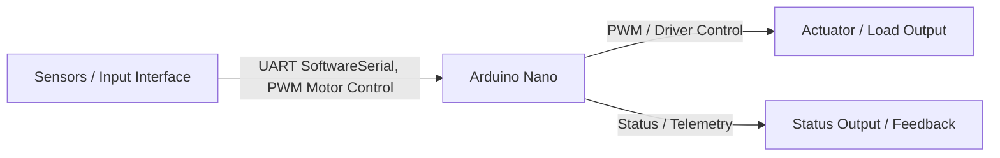
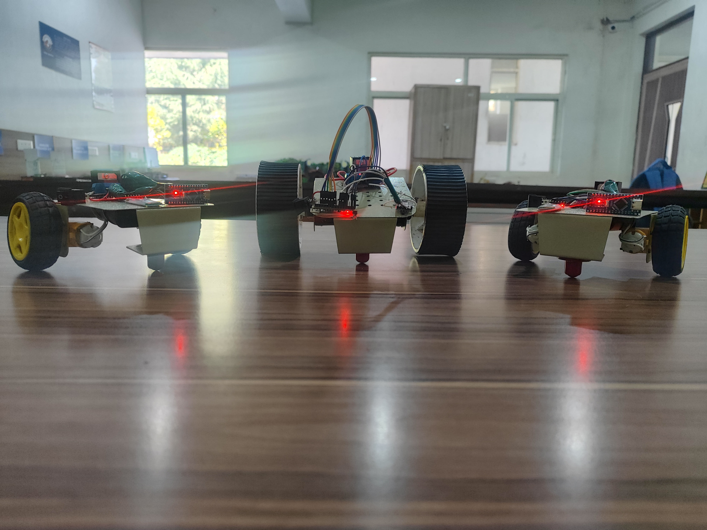
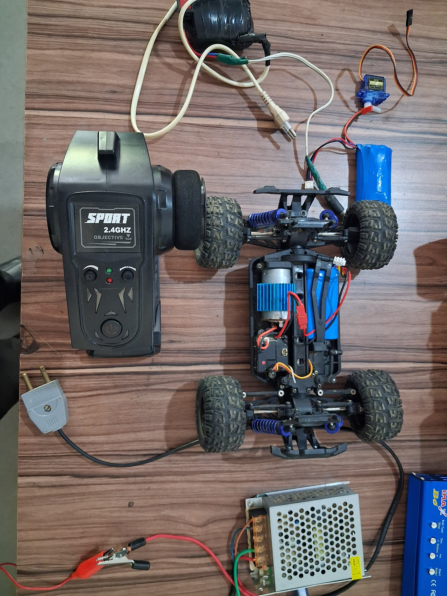

# Bluetooth Serial Robot Car with DFPlayer Mini Audio Integration

 

> **Embedded Hardware & Firmware Project | Graphic Era Hill University (B.Tech ECE 2023–2027)**  
> **Author:** Parth Dalakoti (*President, Robotics & Automation Club, GEHU*)  
> **Contact:** `parthdalakoti482@gmail.com` | [LinkedIn](https://linkedin.com/in/parthdalakoti)

---

## ⚡ Executive Engineering Summary
Bluetooth Serial Controlled Robot Car with DFPlayer Mini Audio Synthesis and Motor Driver. This project is an independent engineering system designed, built, and tested by **Parth Dalakoti** during his B.Tech in Electronics & Communication Engineering.

---

## 🛠️ Hardware Stack & Specifications
* **Target Microcontroller:** `Arduino Nano`
* **Primary Protocols & Interfaces:** `UART SoftwareSerial, PWM Motor Control`
* **Firmware Location:** [`firmware/`](firmware/)
* **Technical Documentation & Reports:** [`docs/`](docs/)
* **Hardware Wiring & Schematics:** [`hardware/`](hardware/)

---

## 🔌 Hardware Connections & Architecture

---

## 🚀 How to Build & Flash
1. Open the source code in [`firmware/`](firmware/) using **Arduino IDE** or **VS Code PlatformIO**.
2. Select target board: `Arduino Nano`.
3. Configure serial baud rate (115200 or 9600 baud as defined in firmware).
4. Connect board and flash.

---

## 👨‍💻 Engineering Author
**Parth Dalakoti**  
*President, Robotics & Automation Club*  
*B.Tech in Electronics & Communication Engineering (2023–2027)*  
*Graphic Era Hill University (GEHU), Bhimtal Campus*  
*Contact:* `parthdalakoti482@gmail.com` • [GitHub Profile](https://github.com/ParthDalakoti)

---

## 📸 Hardware Bench Test Photos

---

## 🏎️ High-Speed Suspension Race Chassis & Telemetry

<table>
  <tr>
    <td width="100%" align="center">
      
       
      <b>High-Speed Differential Drive Race Chassis</b>
       
      <i>4WD chassis with coilover spring suspension, aluminum heat sink brushed motor, and precision steering servo</i>
    </td>
  </tr>
</table>
